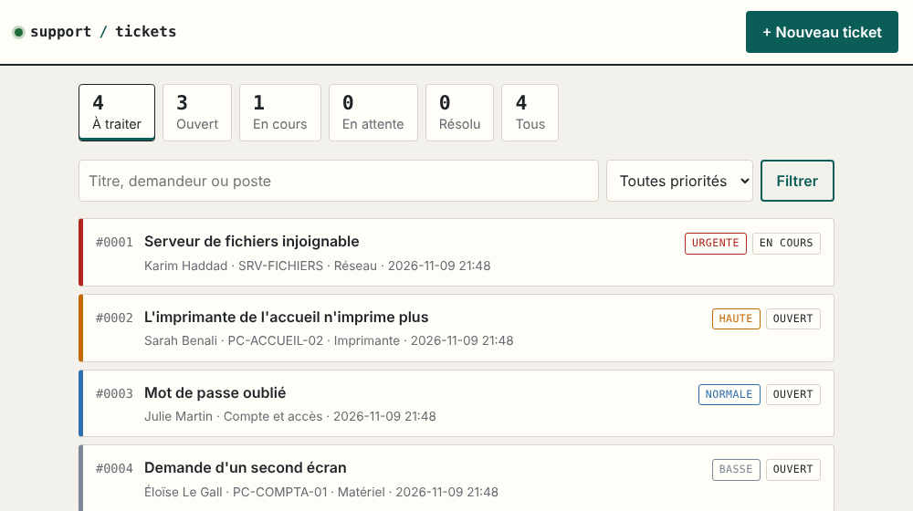

# Mini-ticketing

Petite application web pour suivre les demandes de dépannage informatique d'une structure :
qui a demandé quoi, sur quel poste, où en est l'intervention et comment le problème a été résolu.

Python, Flask et SQLite. Une seule dépendance, aucune base de données à installer.



## Fonctions

- Création d'un ticket : titre, description, demandeur, poste concerné, catégorie, priorité.
- Liste triée par priorité puis par ancienneté, pour traiter le plus urgent en premier.
- Filtres par statut et par priorité, recherche sur le titre, le demandeur ou le poste.
- Fiche de suivi : chaque changement de statut ou de priorité est daté dans l'historique.
- Un ticket ne peut pas être clôturé sans note décrivant la solution, pour que l'historique
  serve de base de connaissances la prochaine fois que la panne se produit.
- Affichage adapté au téléphone, thème clair ou sombre selon le réglage de l'appareil.

## Installation

```
python -m venv .venv
source .venv/bin/activate        # sous Windows : .venv\Scripts\activate
pip install -r requirements.txt
python app.py
```

Puis ouvrir http://127.0.0.1:5000. La base `tickets.db` est créée au premier lancement.

| Variable | Rôle | Défaut |
|---|---|---|
| `TICKETS_BASE` | chemin du fichier SQLite | `tickets.db` |
| `TICKETS_CLE` | clé secrète des sessions | aléatoire à chaque démarrage |

## Organisation du code

```
app.py              routes, validation et accès à la base
templates/          pages HTML (Jinja2)
static/style.css    mise en forme
tests/test_app.py   tests automatiques
```

Deux tables : `tickets` et `notes` (l'historique d'un ticket). Le schéma est en haut de `app.py`.

## Sécurité

- Requêtes SQL paramétrées : pas d'injection possible par les champs de saisie.
- Contenu saisi échappé à l'affichage : pas d'exécution de script (XSS).
- Jeton CSRF vérifié sur chaque formulaire.

**Limite** : il n'y a pas de comptes utilisateurs. L'application écoute uniquement sur le poste
local. Pour un usage en réseau, il faut la placer derrière un serveur web avec authentification
(par exemple nginx et gunicorn) et ne pas utiliser le serveur de développement de Flask.

## Tests

```
python -m unittest discover -s tests
```

## Licence

MIT
